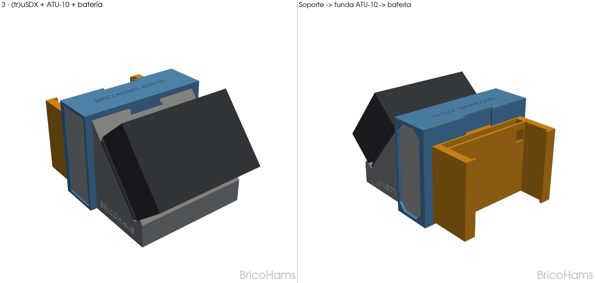
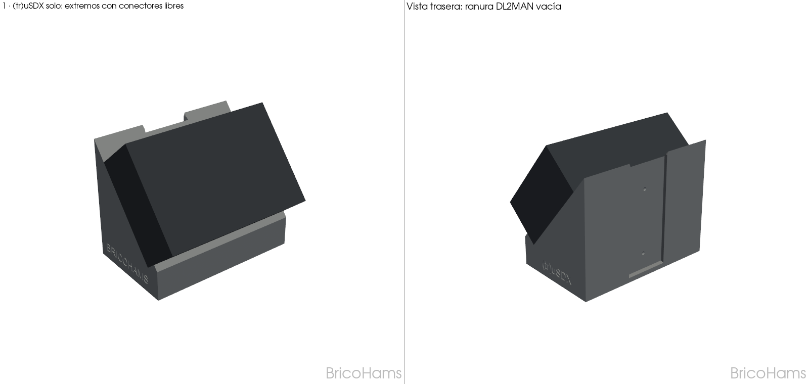
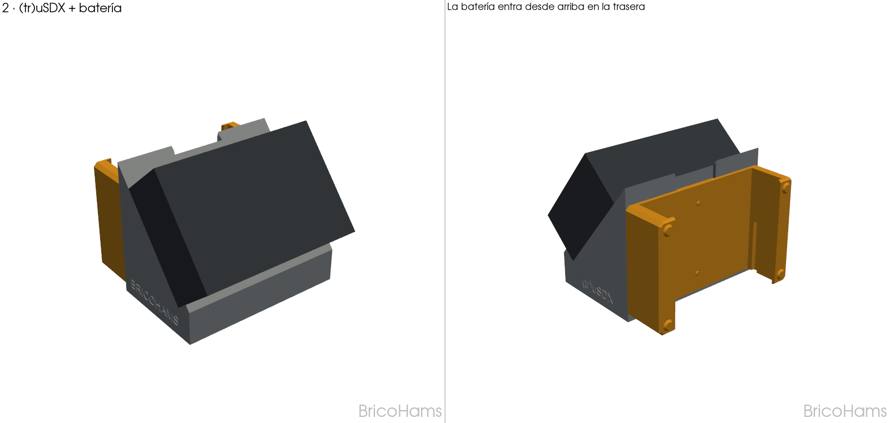
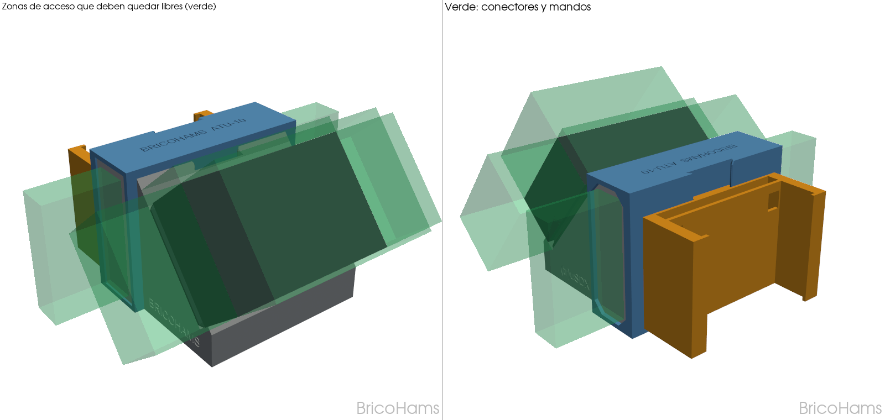
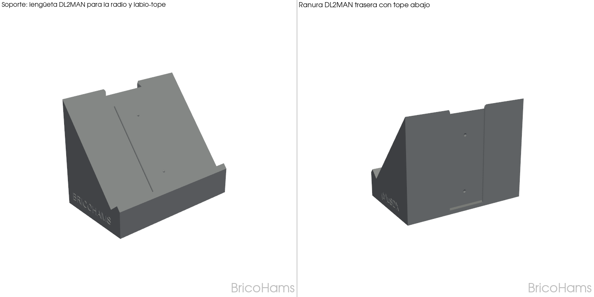
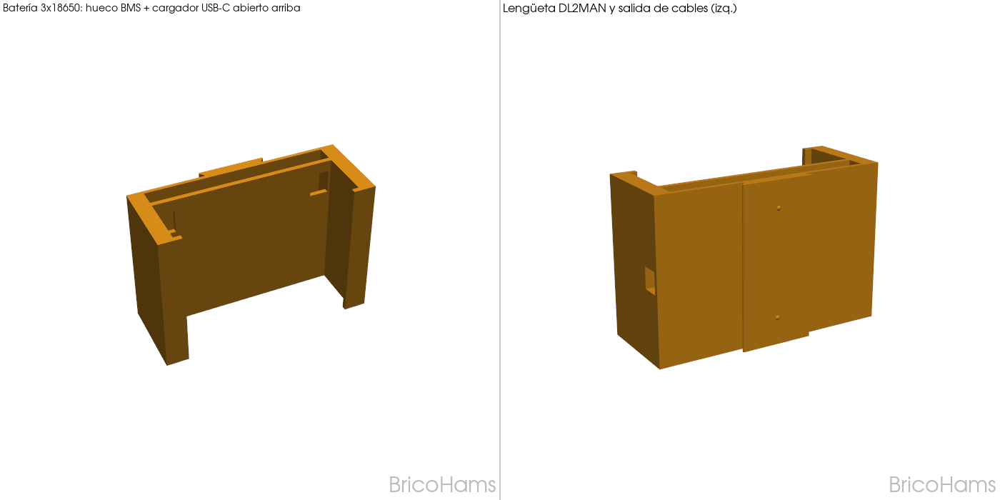
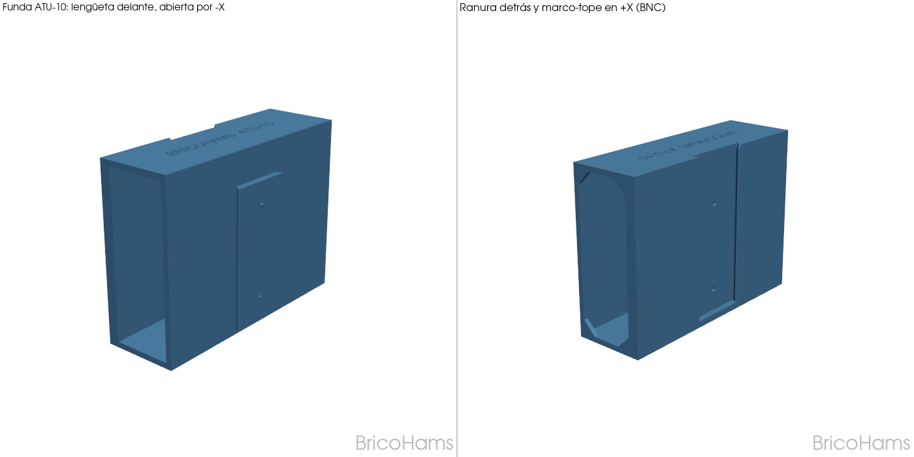
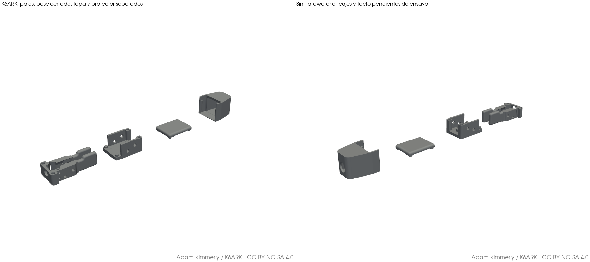
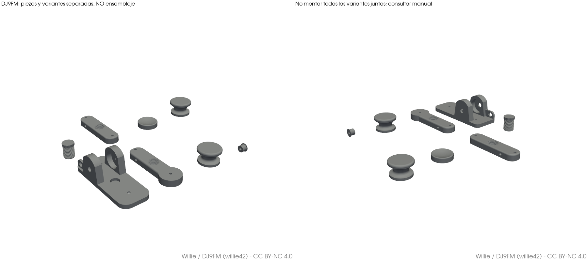
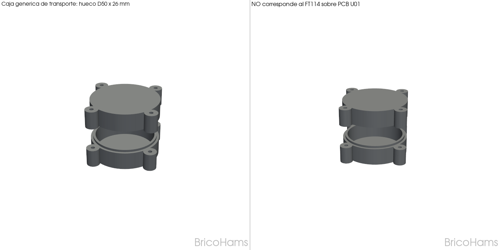

# (tr)uSDX · Sistema modular de riel — BricoHams

Soporte de mesa para el transceptor QRP **(tr)uSDX** con módulos que se enganchan entre sí sin herramientas:

| Módulo | Pieza | Se usa solo | Se engancha |
|---|---|---|---|
| **Soporte del (tr)uSDX** | `stl/trusdx-stand_rail_BricoHams.stl` (nuevo) | Sí: la radio a 50°, enganchada por su riel | Lengüeta en la pendiente (radio) + ranura en la trasera |
| **ATU-10** (N7DDC) | `stl/atu10-sleeve_rail_BricoHams.stl` (nuevo) | Sí: funda de mesa | Lengüeta delante + ranura detrás |
| **Batería 3×18650** | `stl/battery-3x18650_rail_BricoHams.stl` (nuevo) | Sí, o bajo la radio | Lengüeta DL2MAN; hueco para BMS 3S + cargador USB-C |

El portapilas seleccionado por el usuario es triple, de **75,6 × 61,5 × 18,3 mm anunciados**.
Su alojamiento y retención en el STL actual **no están validados**: ver el [prototipo P0](docs/04_prototipo_test.md).
La caja [3S Battery Case de Richard Sisol](https://makerworld.com/es/models/1583590-3s-battery-case#profileId-1666971)
queda como referencia estudiada, no como solución seleccionada.

Todas las uniones usan **el mismo riel de cola de milano que DL2MAN** usa para llevar la batería bajo la radio,
con sus detents de clic. La radio (con la tapa `bottom_cover_battery.stl` de DL2MAN) se desliza por la lengüeta de la
pendiente hasta el labio. Los demás módulos se encadenan por detrás y se encajan **desde arriba**, hasta un tope:

| Combinación | Orden (de delante a atrás) |
|---|---|
| (tr)uSDX solo | soporte |
| (tr)uSDX + batería | soporte → batería |
| (tr)uSDX + ATU-10 + batería | soporte → funda ATU-10 → batería |



Nada se pone a los lados de la radio: sus dos extremos (antena, MIC/KEY y auriculares a la derecha; DC y USB a la izquierda)
y la cara superior (pantalla, mando y pulsadores) quedan libres en las tres combinaciones. El ATU-10 queda con sus BNC a la
derecha, junto a la antena de la radio, y su pantalla, botón y USB-C a la izquierda.
Ver la [comprobación de choques y accesos](docs/verificacion.md).

| (tr)uSDX solo | (tr)uSDX + batería | Zonas de acceso comprobadas |
|---|---|---|
|  |  |  |

| Soporte | Batería con hueco para BMS y cargador | Funda ATU-10 |
|---|---|---|
|  |  |  |

## Documentación

1. [Proceso de diseño y medidas](docs/01_proceso_diseno.md)
2. [Impresión](docs/02_impresion.md)
3. [Montaje, cableado y materiales](docs/03_montaje.md)
4. [Verificación de choques y accesos](docs/verificacion.md)
5. [Atribución y licencias](ATTRIBUTION.md)
6. [Prototipo P0: archivo a imprimir y pruebas de aceptación](docs/04_prototipo_test.md)
7. [Pala doble K6ARK: cuatro STL, BOM y montaje](docs/05_llave_morse.md)
8. [Protector de transporte de toroide P0: STL paramétricos y límites](docs/06_protector_toroide.md)
9. [Antena U01 FT114-43: aisladores, devanador, cubierta de referencia y BOM](docs/07_antena_u01.md)
10. [Estado general, orden de fabricación y transporte bajo el atril](docs/08_estado_general.md)
11. [Llave recta magnética DJ9FM: STL, variantes, BOM y montaje](docs/09_llave_recta_dj9fm.md)

## Accesorios portátiles P0

Las imágenes son vistas de geometría, **no fotografías de montajes ensayados**. La radio y el ATU-10
se representan de forma simplificada. No se muestran placas, cables ni tornillería real.

| Pala doble K6ARK | Llave recta DJ9FM |
|---|---|
|  |  |
| [Cuatro STL, montaje y BOM](docs/05_llave_morse.md) | [STL, variantes, montaje y BOM](docs/09_llave_recta_dj9fm.md) |

Se ofrecen **ambas alternativas**: K6ARK con bisagras de PETG para keyer iámbico y DJ9FM con
rodamientos e imanes para manipulación recta. Las piezas originales conservan autoría y licencia;
no son diseños nuevos de BricoHams. La antigua llave recta P0 se ha retirado; queda en el historial Git.
Las geometrías están comprobadas digitalmente, no el montaje físico ni el ajuste del hardware.

| Accesorios U01 | Caja genérica de toroide suelto |
|---|---|
|  |  |
| [Montaje y BOM](docs/07_antena_u01.md) | [No sirve para la PCB U01](docs/06_protector_toroide.md) |

Para preparar la electrónica en la batería BricoHams actual, ver la
[comprobación de envolventes de BMS y cargador](docs/03_montaje.md#preparar-la-electrónica-para-la-batería-bricohams-actual).

## Regenerar las piezas

Los tres módulos originales se modelan en **Fusion 360**:

1. Ajusta las medidas en `src/dims.py` (inclinación, holguras del riel, medidas del ATU-10, `CALL` = tu indicativo
   para la marca de agua).
2. En Fusion 360: *Utilidades > Scripts y complementos > +* y elige `fusion/trusdx_rail_fusion.py`. Crea un diseño nuevo
   con los tres componentes y su historial, y exporta sus STL y STEP.
3. Los accesorios P0 usan generadores Python independientes. No modifican los módulos Fusion:

```powershell
python -m venv .venv
.\.venv\Scripts\python.exe -m pip install -r requirements.txt
.\.venv\Scripts\python.exe src\prepare_k6ark.py
.\.venv\Scripts\python.exe src\prepare_dj9fm.py
.\.venv\Scripts\python.exe src\toroid_case.py --diameter 50 --height 26  # ejemplo, no cubierta U01
.\.venv\Scripts\python.exe src\antenna_accessories.py
.\.venv\Scripts\python.exe -m unittest discover -s src -p "test_*.py"
.\.venv\Scripts\python.exe src\verify.py          # regenera docs\verificacion.md
.\.venv\Scripts\python.exe src\render_previews.py # 11 vistas PNG
```

Las dependencias no incluyen un lector de PDF: el esquema U01 se consulta como documento externo.
La cubierta FT114 original y el PDF conservan los derechos de sus autores y no se redistribuyen aquí.

> **Versiones anteriores:** la v1 (riel en la trasera del soporte KD9WNR) y la v2 (riel en el lateral izquierdo) dejaban
> la batería tapando los conectores DC/USB de la radio o el sitio del ATU-10. Esta v3 lo resuelve con la cadena por detrás.

## Licencia

Las piezas nuevas: **CC BY-NC-SA 4.0** — ver [LICENSE.md](LICENSE.md).
Las piezas originales mantienen la licencia de sus autores — ver [ATTRIBUTION.md](ATTRIBUTION.md).

---
**BricoHams** · hecho por radioaficionados, para radioaficionados.
