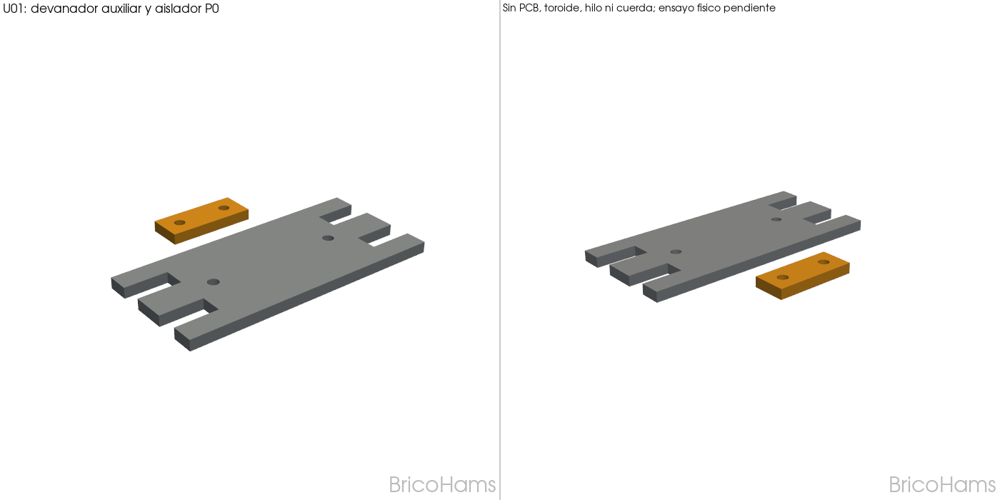

# 7 · Kit mecánico de prueba para antena U01

## Referencias e identificación

El esquema aportado por el usuario, `U01-Antenne.pdf`, de una página, es de DJ5RE
y cita piezas imprimibles de DL2MAN. Se consulta localmente; no se incorpora al control
de versiones ni se concede permiso de redistribución sobre él. Consultar la
[página original U01](https://dl2man.de/u01-emergency-communications-antenna/) para las referencias públicas.
La fotografía corregida muestra una PCB devanadera marcada **FT114-43, 1:49 UnUn,
3T:21T, max. 25W**, con condensador marcado 100 pF y conector SMA instalado.
Es identificación visual, no verificación de prestaciones ni autorización para 25 W continuos.

La [página original U01](https://dl2man.de/u01-emergency-communications-antenna/)
enlaza una [cubierta específica FT114-43](https://dl2man.de/wp-content/uploads/2022/10/Abdeckung_FT114-43.zip)
y los [archivos de PCB FT114](https://dl2man.de/wp-content/uploads/2022/10/EFHW_HASP_FT114.zip).
El ZIP de cubierta contiene `Abdeckung_FT114-43.stl`. Usar esa referencia original para
la PCB correspondiente, sin afirmar compatibilidad con todas las revisiones o bobinados.
No se ha copiado esa geometría a los STL BricoHams ni se le aplica su licencia.
Se ha descargado sin modificar al espacio de trabajo de la sesión: su envolvente es de
**41 × 53 × 6 mm**, y su malla es cerrada y de orientación consistente. Estas medidas no
demuestran que una sola pieza cubra ambas caras ni el ajuste con la PCB del usuario;
comprobar la disposición, separaciones y fijaciones originales antes de imprimir el juego definitivo.

## STL BricoHams nuevos

| Pieza | Cantidad inicial | Uso |
|---|---|---|
| [Aislador P0](../stl/u01-insulator_P0_BricoHams.stl), 40 × 16 × 5 mm | 4 | Dos extremos y dos uniones entre tramos como punto de partida; dos agujeros Ø5 mm |
| [Devanador auxiliar P0](../stl/u01-wire-winder_P0_BricoHams.stl), 120 × 55 × 5 mm | 1 opcional | Recogida de hilo independiente; no sustituye la PCB con transformador |

Geometrías originales generadas por [src/antenna_accessories.py](../src/antenna_accessories.py).
PETG, capa 0,2 mm, 4 paredes, 35 % de relleno, planos sobre la cama, sin soportes.
Redondear suavemente las aristas que contacten con hilo/cuerda y eliminar rebabas.
No hay capacidad de enrollado, resistencia a tracción, aislamiento RF ni vida a la intemperie
certificados. Estos accesorios no son elementos de seguridad ni para suspender cargas sobre personas.

## BOM del conjunto de test

| Elemento | Cantidad / referencia |
|---|---|
| PCB devanadera FT114, núcleo y bobinado | 1 conjunto como el identificado; seguir la documentación original de esa revisión |
| Cubierta del transformador | Referencia FT114-43 original anterior; prueba de ajuste pendiente |
| Hilo de antena | Tres tramos según esquema; referencia del autor: DX-Wire UL |
| Conectores eléctricos entre tramos | 2 pares; referencia de la página: conectores RC de 2 mm |
| Cuerda aislante | Para ambos extremos y soporte según emplazamiento; referencia del autor: poliéster de 2 mm |
| Aisladores impresos | 4 como selección inicial; comprobar alivio de tracción en uniones y extremos |
| Coaxial | **Mínimo 5 m según esquema**, impedancia de 50 ohmios y conectores adecuados al montaje |
| Conector RF del transformador | SMA en la foto; la PCB contempla SMA/BNC, no montar ambos por defecto |
| Latiguillo/adaptador a la radio o ATU | Según los conectores realmente instalados; no unir una salida RF a alimentación/audio |
| Devanador auxiliar | 1 opcional, si la PCB no recoge cómodamente el hilo elegido |

La longitud de cuerda y las fijaciones dependen del emplazamiento: no se deducen de una foto.
No atribuir al condensador de la foto una tensión admisible solo por leer «100p».

## Tramos y despliegue

El PDF anota:

| Tramo | Longitud indicada | Anotación adicional del esquema |
|---|---|---|
| 40 m, con 20/15/10 m | 19,77 m | +0,25 m |
| Extensión 60 m | 6,63 m | +0,2 m |
| Extensión 80 m, con 17 m | 12,8 m | +0,2 m |

Conservar las anotaciones adicionales como referencia para preparación/terminaciones;
no cortarlas a ciegas como longitudes universales ya ajustadas. La página del autor
indica que las longitudes incluyen los bucles que conectan los segmentos.
El dibujo muestra además una cota de 6 m asociada al despliegue.
Consultar el esquema completo para la disposición; la extracción de texto no prueba la posición
de sus flechas ni sustituye el dibujo.

1. Preparar el primer tramo desde el terminal de antena del UnUn; añadir las extensiones
   mediante conexiones desmontables para las configuraciones del esquema.
2. Separar esfuerzo mecánico y contacto eléctrico: usar cuerda/bucles/aisladores para que
   los conectores y las soldaduras del transformador no soporten la tracción del hilo.
   No pasar cuerda por encima del bobinado ni presionarlo con la cubierta.
3. Ensayar aisladores, devanador y cubierta en vacío y después con el hilo, sin transmitir.
   No forzar el cierre, perforar una PCB desconocida ni aprisionar terminales.
4. Medir continuidad y ausencia de cortos no previstos, y ajustar con analizador/VNA en
   la instalación real antes de transmitir. La pertenencia a una banda no garantiza ROE admisible.
5. Hacer las primeras pruebas RF supervisadas a baja potencia; no elevar potencia ni declarar
   estanqueidad por instalar una cubierta. Respetar límites del conjunto y documentación original.

Mantener antena y cuerdas lejos de líneas eléctricas y lugares de paso; no desplegar con tormenta
ni tocar hilo/terminales durante transmisión. Desmontar al terminar las pruebas.

## Estado

Los dos STL nuevos se verifican como sólidos cerrados y únicos. No se han realizado ensayos
físicos ni RF. La cubierta original queda como referencia de montaje sobre PCB; la
[caja genérica de toroide suelto](06_protector_toroide.md) **no corresponde a este conjunto**.
